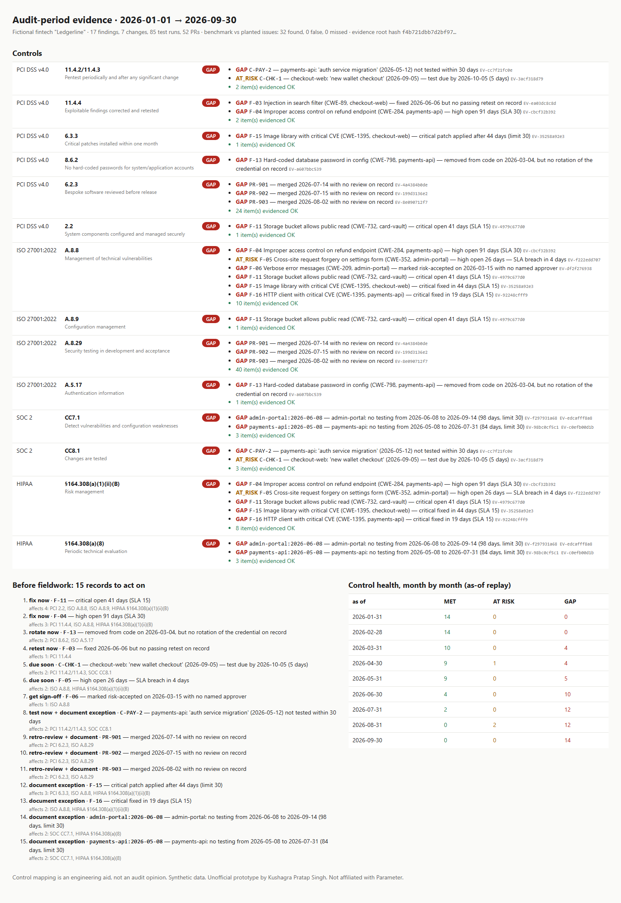

# Audit-period evidence compiler for continuous security testing (prototype)

**The problem.** [Parameter](https://parameter.ai/pentesting) runs continuous testing and sells it partly on compliance: an auditor report with compliance mapping, PCI DSS 11.4 coverage "between annual assessments", and SOC 2 / ISO 27001 / HIPAA evidence. Continuous testing changes what an auditor asks. The question isn't "show me the pentest report" anymore. It's "show me the control worked **across the whole audit period**":
- every critical/high finding fixed within policy *and retested*
- each card-data system retested after every significant change
- critical patches applied within a month
- exposed secrets rotated, not just deleted
- merged code reviewed

A per-test report doesn't answer that. A timeline of evidence does.

**What I built.** A compiler that reads a continuous-testing record stream (findings from 5 sources, the asset scope, significant changes, test runs, merged PRs) plus the customer's remediation policy. It evaluates 14 controls over the audit period:

| Framework | Controls (check behind each) |
|---|---|
| PCI DSS v4.0 | 11.4.2/11.4.3 tested after every significant change · 11.4.4 fixed **and** retested · 6.3.3 critical patch ≤ 1 month · 8.6.2 secret rotated · 6.2.3 PR reviewed · 2.2 config findings within SLA |
| ISO 27001:2022 | A.8.8 remediation SLA + named risk acceptance · A.8.9 config · A.8.29 review · A.5.17 secrets |
| SOC 2 | CC7.1 test cadence gaps · CC8.1 changes tested |
| HIPAA | §164.308(a)(1)(ii)(B) risk management SLA · §164.308(a)(8) periodic evaluation |

The controls are stored as data, so one record can back several controls and adding a framework means adding rows. Each control item cites **evidence IDs** (SHA-256 of the source record), and the pack has a root hash, so changing any record changes the pack.

On top of the per-control verdicts:
- **Before fieldwork:** one line per underlying record, with every control it affects and the right action: *fix now / rotate now / retest now / due soon / get sign-off / document exception*. A critical finding fixed 44 days late can't be "fixed" anymore; it needs an exception memo, and the tool says so.
- **As-of replay:** control state on any date. Here: 14/14 MET in February, 0/14 by September. You can see exactly when each control slipped.
- **Same finding, different verdicts:** a critical dependency patched in 19 days passes PCI 6.3.3 (one month) but fails the customer's own 15-day SLA under ISO A.8.8.

## Result (synthetic: fictional fintech "Ledgerline", Jan–Sep 2026)

- 17 findings, 7 changes, 85 test runs, 52 PRs → **32/32 planted control issues found, 0 false, 0 missed.** Edge cases handled correctly:
  - a retest failed then passed
  - a fix on exactly the SLA day
  - risk acceptance with an approver vs. without one
  - non-significant changes, and out-of-scope assets and PRs (ignored)
- 15 underlying records explain every open item across 14 controls. The demo runs in 0.03 s.
- Honest limits: I wrote this dataset and its labels myself, so the benchmark shows the checks behave as designed, not real-world accuracy. Control wording is paraphrased, and the mapping is an engineering aid, not an audit opinion. I use a finding's first-seen date as a stand-in for the patch release date in 6.3.3. This is evidence-side only: it doesn't run, perform or describe any testing.



## Run

```bash
python data/make_data.py    # regenerate synthetic records (already committed)
python demo.py              # → out/auditor_view.html, out/controls.csv, out/evidence_manifest.csv
pip install pytest && python -m pytest -q   # 11 tests
```

Standard-library Python only.

## Layout

```
auditpack/controls.py   framework → control → check → scope (data)
auditpack/evaluate.py   period checks, evidence ids, as-of evaluation, fieldwork list, manifest + root hash
data/                   synthetic policy, assets, findings, changes, test runs, PRs, labels.json
demo.py                 console + HTML auditor view + CSVs + month-by-month replay
```

Unofficial prototype by Kushagra Pratap Singh. Not affiliated with Parameter.
